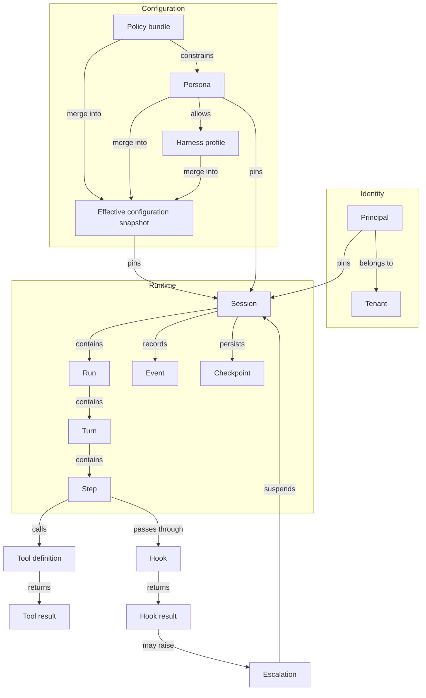

# agentry — Domain model

**Status:** Approved 2026-10-31 (Phase 1) · **Owner:** John Akinyele, Alphega Solutions · **Date:** 2026-10-31
**Built from:** `intent.md` (approved) and settled notes `core.md`, `config.md`, `tools.md`, `hooks.md`, `security.md`

> This document fixes agentry's **vocabulary and the relationships between concepts**. It defines what each thing *is*, not its fields or formats; those come in the Phase 3 specs. Approval gates Phase 2 (ADRs).
>
> Terms marked *(provisional)* are needed now but will be refined by Tier 2 notes before their Phase 3 specs.

---

## 1. Concept map

Read top to bottom: configuration is merged into a snapshot; a session is pinned to a snapshot, a principal, and a persona; work inside the session happens in runs, turns, and steps, and every step's model calls, tool calls, and hook decisions are recorded as events.

---

## 2. Runtime

| Term | Definition |
|---|---|
| **Session** | A durable conversation between one principal and one persona, pinned at creation to that principal, its tenant, the persona, and one configuration snapshot. The unit of durability. |
| **Session state** | One of `active`, `idle`, `suspended`, `closed`. A closed session records why: `completed`, `cancelled`, `failed`, or `expired`. |
| **Session TTL** | How long an `idle` or `suspended` session lives before it expires. Always set explicitly in the harness profile. |
| **Run** | One call to `run()` or `resume()`. Produces one ordered event stream and ends with exactly one run end reason. At most one run is active per session. |
| **Run end reason** | Why a run ended: `responded`, `escalated`, `blocked`, `step_limit`, `budget_exhausted`, `context_limit`, `timeout`, `cancelled`, `failed`. Determines the next session state. *(`context_limit` added 2026-10-31 by Area 7.)* |
| **Turn** | One principal input and the agent's work until it responds or suspends. |
| **Step** | One model call plus the tool calls that call requested. |
| **Event** | An immutable record of something that happened in a session. Events form the trace, the audit source, and the input to replay. |
| **Event envelope** | The fields every persisted event shares: identity, position, ordering, tenant, principal reference, snapshot hash, trace context, provenance, sensitivity. |
| **Sequence number** | A per-session, strictly increasing, gap-free number on every persisted event. The only ordering authority; timestamps are informational. |
| **Ephemeral event** | An event that is streamed but never persisted or sequenced. In 1.0 only token deltas (`model.delta`). |
| **Checkpoint** | The persisted state of a session from which a run can resume. Versioned, so concurrent writers are detected. |
| **Fallback message** | The fixed response returned whenever a run ends `blocked`, at input or output. Declared in the persona or policy bundle; never model-generated. *(Amended 2026-10-31 by Area 1, CORE-181.)* |
| **Delivery mode** | How responses leave the harness: `buffered` (default; output hooks see the full response first) or `streamed` (deltas pass through; output hooks are advisory). |

## 3. Configuration

| Term | Definition |
|---|---|
| **Artifact** | One unit of configuration in its own file, identified by kind, ID, and an integer version. |
| **Configuration kind** | The type of an artifact: `PolicyBundle`, `Persona`, `HarnessProfile`, `Tool`, `Hook`, `Deployment`. |
| **Artifact reference** | An exact pointer to another artifact, written `id@version`. No ranges. |
| **Policy bundle** | Mandatory organisational rules: required hooks, sensitivity policies, trusted tools, allowed providers, taint defaults. Bundles may be stacked; each lower bundle can only tighten. |
| **Persona** | Declares **who** an agent is: instructions, tool allowlist, required hooks, fallback message, default and allowed profiles. |
| **Harness profile** | Declares **how** a persona runs: limits, budgets, context strategy, checkpointing, delivery mode, TTLs, trace settings. |
| **Deployment** | Declares **where** agentry runs: provider endpoints, storage port bindings, secrets provider, environment. Cannot change behaviour or policy. |
| **Configuration layer** | A level in the behavioural precedence order: policy bundle(s) → persona → harness profile → run request. |
| **Merge rule** | How a field combines across layers, declared in the schema: `union`, `intersect`, `min`, `stricter`, `locked`, `override`. Loosening is an error, never a silent clamp. |
| **Effective configuration snapshot** | The immutable, fully validated result of loading and merging all artifacts. Configuration loads completely or not at all. |
| **Snapshot hash** | The content hash identifying a snapshot. Carried on every event and audit record. |
| **Config source** | Where artifacts are read from (files by default). A port. |
| **Environment overlay** | Environment-specific values (`dev`, `staging`, `prod`) on the deployment axis; may tighten behaviour, never loosen policy. |
| **Secret reference** | A pointer to a secret (`secret://provider/name`). Configuration never contains secret values. |

## 4. Identity and isolation

| Term | Definition |
|---|---|
| **Principal** | Who a session acts on behalf of: subject, tenant, roles, attributes, assurance level. Supplied by the host, immutable for the session. agentry never authenticates. |
| **Service principal** | An explicit principal for unattended runs. There is no anonymous mode. |
| **Assurance level** | How strongly the principal was authenticated. Tools may require a minimum. |
| **Tenant** | The isolation boundary. Every session, storage record, retrieval, and cache entry belongs to exactly one tenant; cross-tenant access behaves as not found. |
| **Reviewer** | A human principal who decides an escalation. Recorded separately; never replaces the session principal. |

## 5. Tools

| Term | Definition |
|---|---|
| **Tool definition** | The language-neutral description of a tool: input and output schemas, effect, egress, idempotency, approval policy, sensitivity labels, credential mode, timeout, minimum assurance, taint behaviour. What governance acts on. |
| **Binding** | How an implementation invokes a tool: `native`, `mcp`, `http`, `agent`, or a framework adapter. |
| **Tool source** | Where definitions come from: native functions, MCP servers, OpenAPI operations, sub-agents, framework imports. All normalize to tool definitions. |
| **Tool catalog** | Every tool known to a deployment. |
| **Persona allowlist** | The tools a persona may use. |
| **Runtime scope** | The tools available for a specific call, narrowed by the host's authorization context. The model sees only catalog ∩ allowlist ∩ runtime scope. |
| **Effect** | Whether a tool only reads (`read`) or changes state (`mutating`). |
| **Egress** | Whether a tool sends data outside the trust boundary. Independent of effect. |
| **Approval policy** | When a tool call needs human approval: `never`, `policy`, `always`. |
| **Credential mode** | Whether a tool runs with the principal's credentials (`principal`) or a shared service credential (`service`, which must enforce the principal's rights itself). |
| **Tool context** | What every tool call receives: session, principal, idempotency key, deadline, cancellation signal, trace context. |
| **Tool result** | `ok` with output, or an error. Carries the tool's provenance and sensitivity labels. |
| **Idempotency key** | A key that guarantees a mutating call is performed at most once, including across resume. |
| **Delegation** | One persona invoking another as a tool. The sub-agent runs as a nested session with the caller's principal and a scope that can only narrow. |

## 6. Hooks and guardrails

| Term | Definition |
|---|---|
| **Hook** | A typed extension point in the loop that returns a decision. |
| **Hook point** | Where a hook runs: `sessionStart`, `beforeModelCall`, `afterModelCall`, `beforeToolCall`, `afterToolCall`, `beforeResponse`, `onError`, `sessionEnd`. |
| **Hook result** | What a hook returns: `continue`, `annotate`, `rewrite`, `block`, `escalate`. Each hook declares which it may return. |
| **Hook decision** | The audited record of a non-`continue` hook result. |
| **Guardrail** | A hook with a governance purpose. Fails closed by default. |
| **Guardrail pipeline** | An ordered set of guardrails at a hook point. Rewrites chain; the first block or escalate stops the chain. |
| **Failure mode** | What happens when a hook errors or times out: `failClosed` (treated as block) or `failOpen` (treated as continue). |
| **Finding** | Information a hook attaches without changing content, via `annotate`. |
| **Rule** | A declarative hook condition with no code, written in the CEL subset. |
| **CEL subset** | The portion of the Common Expression Language that agentry permits, so rules behave identically in all implementations. |
| **Rule evaluator** | The component that compiles and runs rules; replaceable per implementation. |
| **Remote hook** | A hook implemented as an external service, shared across implementations. |
| **Model-judged hook** | A hook that uses a model as a classifier. Constrained to the hook result schema, runs without tools, and its model calls bypass the hook chain. |

## 7. Content, sensitivity, and trust

| Term | Definition |
|---|---|
| **Sensitivity label** | A tag on content describing how it must be handled. Well-known labels: `pii`, `phi`, `pci`, `secret`; custom labels are namespaced. |
| **Sensitivity policy** | Configuration that maps labels to behaviour: redaction, allowed providers, trace handling, approval. An unmapped label is a configuration error. |
| **Provenance** | Where content came from: `system`, `principal`, `tool:<name>`, `retrieval:<source>`, `agent:<persona>`, `model`. Survives transformation. |
| **Trust level** | Whether content may influence actions freely (`trusted`) or not (`untrusted`). Assigned by configuration, never by the content. |
| **Taint** | The state of a turn — and, in 1.0, the rest of its session — once untrusted content has entered context. |
| **Taint rule** | The deterministic policy, evaluated before hooks, that restricts tainted turns: mutating tools escalate by default; egress with sensitive content in context is blocked. |

## 8. Errors

| Term | Definition |
|---|---|
| **Error** | The single error shape used by tools, hooks, providers, ports, and the harness: code, category, retryable flag, source, safe message, details. |
| **Error code** | A stable, namespaced identifier (`agentry.tool.timeout`). |
| **Error category** | What drives handling: `invalid_input`, `unauthorized`, `policy`, `limit`, `unavailable`, `conflict`, `not_found`, `configuration`, `cancelled`, `fatal`. |

## 9. Architecture

| Term | Definition |
|---|---|
| **Harness** | The runtime that owns the agent loop for a session: steps, stop conditions, hooks, taint rule, context, checkpoints, tool execution, tracing. |
| **Provider adapter** *(provisional)* | Translates harness requests to one model provider and back. Never runs its own loop. |
| **Port** | A contract for an external capability with swappable adapters: config source, checkpoint store, idempotency store, trace sink, audit log, blob store, vector store, secrets provider. Every storage port is tenant-scoped. |
| **Context manager** *(provisional)* | Assembles what the model sees each step: persona instructions, history, retrieval, compaction. |
| **Escalation** *(provisional)* | A request for a human decision that checkpoints and suspends the session. |
| **Decision** *(provisional)* | A reviewer's answer to an escalation, applied idempotently by `resume()`. |
| **Trace** | The ordered, persisted events of a session, with sensitivity-aware redaction. |
| **Audit log** | The append-only record of governance-relevant events: hook decisions, policy decisions, escalations, mutating tool calls. |

## 10. Conformance

| Term | Definition |
|---|---|
| **Specification** | This repository: intent, domain, ADRs, area specs, schemas, fixtures. The single source of truth. |
| **Conformance fixture** | A data-only test case with inputs and expected outcomes. Fixtures are the arbiter of correct behaviour. |
| **Reference implementation** | An implementation maintained alongside the spec: TypeScript, Java/Spring AI, Python. |
| **Conforming implementation** | Any implementation that passes the full conformance suite for its claimed contract version. |

---

## 11. Invariants

Statements that hold everywhere. Each becomes one or more conformance fixtures.

1. A session's principal, tenant, persona, and snapshot never change.
2. At most one run is active per session.
3. Every persisted event has a unique, strictly increasing, gap-free sequence number within its session.
4. Every run ends with exactly one run end reason.
5. Configuration loads completely and validly, or not at all.
6. A lower configuration layer can only tighten what a higher layer set.
7. The model only sees tools in catalog ∩ persona allowlist ∩ runtime scope.
8. A mutating tool call with a completed idempotency key is never performed again.
9. Trust comes from configuration, never from content.
10. A tainted turn cannot perform a mutating call without approval, nor an egress call with sensitive content in context, unless policy explicitly allows it.
11. Delegation never widens scope.
12. A record from one tenant is never visible to another.
13. Secret values never appear in configuration, events, traces, or audit records.
14. Every non-`continue` hook decision and every policy decision is audited with the snapshot hash.

## 12. Deliberately absent

Concepts that are **not** part of agentry 1.0, recorded so reviewers don't expect them:

- Workflow concepts: graph, edge, timer, schedule, compensation (per Q4).
- Third-party agent loops or memory as core concepts (per Q1).
- Authentication of principals (host responsibility).
- Cross-tenant operations.
- Long-term memory across sessions — **decided out of the 1.0 core** (2026-10-31); hosts provide memory as ordinary governed tools.

## 13. Decisions from Phase 1 review (2026-10-31)

- **D1 — "Run" naming:** Kept. "Run" names both the concept and the `run()` call; `resume()` also starts a run.
- **D2 — Step granularity:** Parallel tool calls requested by one model response form a single step.
- **D3 — Blocked tool calls:** Confirmed. When a guardrail or the taint rule blocks a tool call, the model receives a `policy` error as that tool's result and may continue.

---

## Amendment 2026-10-31 — content model (from `notes/content.md`)

| Term | Definition |
|---|---|
| **Message** | A role (`system`, `principal`, `assistant`, `tool`) and an ordered list of content parts. |
| **Content part** | One piece of a message: `text`, `image`, `file`, `structured`, `tool_call`, `tool_result`, or `reasoning`. Each carries provenance and sensitivity labels. The set is closed in the core. |
| **Blob reference** | A tenant-scoped pointer to binary content in the BlobStore: ID, content hash, media type, size. Events never inline binary data. |
| **Attachment** | An image or file part supplied with a request. Untrusted regardless of who supplied it, unless a policy bundle marks its source trusted. |
| **Default attachment labels** | Sensitivity labels a harness profile assigns to attachments until a hook labels them. |
| **Output schema** | A JSON Schema declared by a persona or profile that the final response's `structured` part must satisfy. Requires `buffered` delivery. |
| **Reasoning part** | Provider reasoning content, possibly opaque. Kept in the checkpoint, never shown to the principal or sent to another provider, excluded from traces by default. |

Invariant 15: Events never contain inline binary content.

## Amendment 2026-10-31 — from Area 1 approval

- **Fallback message** widened to cover every `blocked` run end (see §2).
- New sessions start `idle`. A host may **close** a session: `idle` → `closed` (`completed`), `suspended` → `closed` (`cancelled`).

## Amendment 2026-10-31 — human-in-the-loop (from `notes/hitl.md`)

**Escalation** and **Decision** are no longer provisional.

| Term | Definition |
|---|---|
| **Escalation** | A request for human decision, created when a session suspends. Holds its source, reason code, and one or more pending actions. One escalation per step. |
| **Escalation source** | Why it was raised: `taint`, `approval`, `hook`, or `recovery`. |
| **Pending action** | One item awaiting decision: a tool call, content at a hook point, or a recovery check. |
| **Decision** | A reviewer's answer to one pending action: `approve`, `reject`, `edit`, or `confirm`. Immutable, audited, applied idempotently. |
| **Reviewer rule** | A CEL condition deciding which principals may review an escalation source or see a label's content. |
| **Required approvals** | How many distinct reviewers must approve; any single reject rejects. Default 1. |
| **Expiry action** | What happens when an escalation is not decided before `suspendedTtl`: close the session (default) or reject all pending actions. Never approve. |

Provenance gains one value: **`reviewer`** — content supplied by a reviewer in an `edit` decision. Trusted.

## Amendment 2026-10-31 — context (from `notes/context.md`)

**Context manager** is no longer provisional.

| Term | Definition |
|---|---|
| **Context** | The view of a session the model sees at one step, assembled from events. Compacting it never changes the event record. |
| **Context manager** | Assembles the context for each model call: system content, compacted history, recent history, retrieved content, and the current turn. |
| **Retrieval tool** | An ordinary tool, backed by the vector store port, that the model calls to search. |
| **Automatic retrieval** | Retrieval the context manager performs before a turn's first model call, when enabled in the profile. |
| **Compaction** | Reducing context to fit the model's limit: `truncate` (drop oldest history) or `summarize` (replace it with a model-written summary). |
| **Summary** | Content produced by compaction. Carries the least-trusted provenance and the union of labels of what it replaces; recorded in a `context.compacted` event. |
| **Reserved output tokens** | Context space a profile keeps free for the model's response. |

## Amendment 2026-10-31 — providers (from `notes/providers.md`)

**Provider adapter** is no longer provisional.

| Term | Definition |
|---|---|
| **Provider** | A model vendor endpoint declared in the deployment, with region and data-handling attributes that sensitivity policies can allow or deny. |
| **Model block** | Configuration choosing a provider and model, its parameters, and ordered fallback models. |
| **Capability** | A declared feature of a model: context limit, output limit, tool use, structured output, vision, documents, reasoning, streaming. Declared by adapters; deployments may only restrict. |
| **Fallback model** | An alternative model used when the primary is not allowed for the content in context, lacks a needed capability, or is unavailable. |
| **Sensitivity routing** | Choosing, at each model call, a model whose provider is allowed for every label in context. Content is never sent to a disallowed provider. |
| **Normalized usage** | Token usage in one shape across vendors: input, output, cached input, reasoning. |
| **Price table** | Per-model token prices declared in the deployment, used for cost budgets. |

## Amendment 2026-10-31 — from Area 10

- **Port** list (§9): "trace sink" is replaced by the **event log** (the persisted, ordered events — the system of record) and an optional **telemetry exporter** (observability spans, never a system of record). The **snapshot store** is added. Every storing port is tenant-scoped, encrypted at rest, and never deduplicates across tenants.
- New term — **Legal hold**: a deployment-placed hold on a tenant or session that suspends retention deletion.

